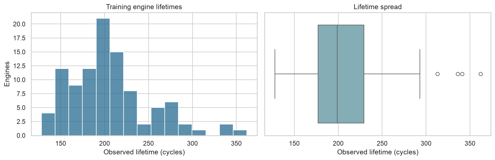
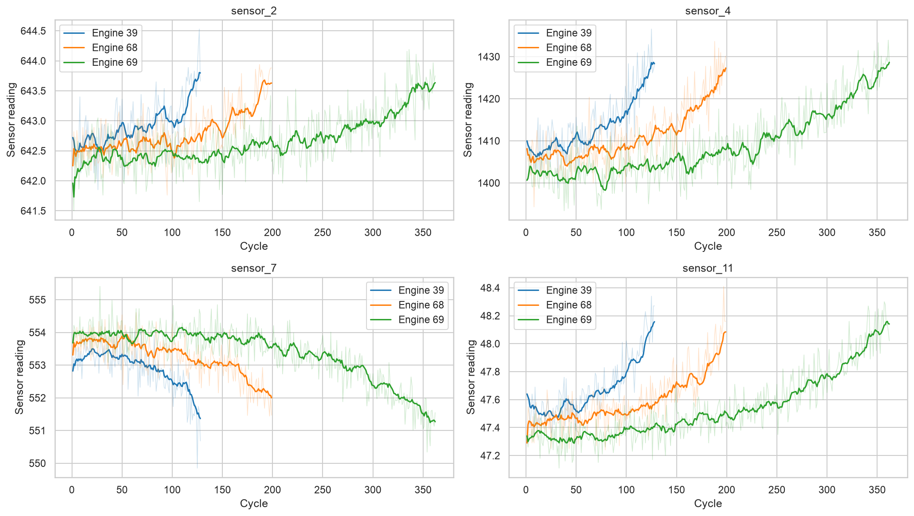
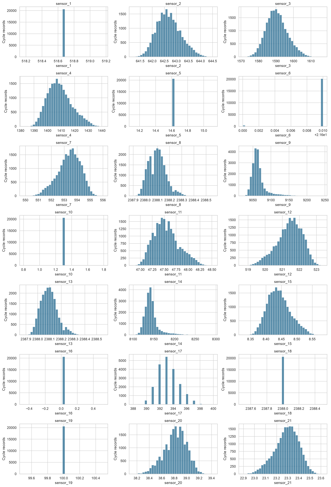
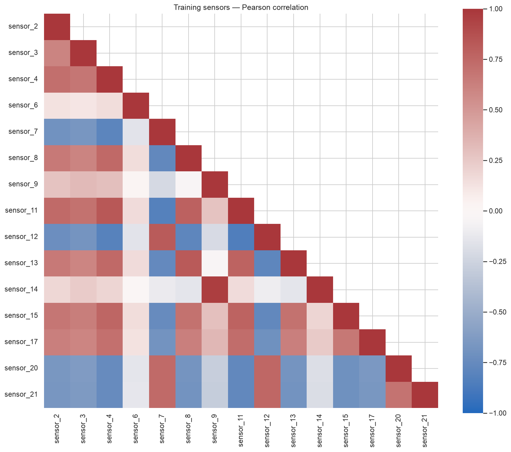

[02_data_understanding.md](https://github.com/user-attachments/files/35085834/02_data_understanding.md)
# 02 — Data Understanding

## Scope and provenance

NASA C-MAPSS FD001, CRISP-DM Data Understanding. Generated at 2026-11-14T19:22:19.840626+00:00.
Source used: https://phm-datasets.s3.amazonaws.com/NASA/6.+Turbofan+Engine+Degradation+Simulation+Data+Set.zip.

[Official dataset description](https://data.nasa.gov/dataset/cmapss-jet-engine-simulated-data) · [NASA PCoE repository](https://www.nasa.gov/intelligent-systems-division/discovery-and-systems-health/pcoe/pcoe-data-set-repository/).

FD001 simulates one operating condition and one HPC degradation fault mode. Training trajectories end at failure; official test trajectories are truncated. Equal unit IDs in different splits do not establish physical engine identity. Only official training data were explored. Test/RUL files were checked structurally; their values and distributions were not used for analysis or selection. No RUL targets, data splits, transformations or models were produced.

### File inventory

Hashes identify the bytes used in this run; they are not independently authenticated NASA checksums.

| file | bytes | sha256 | source |
| --- | --- | --- | --- |
| train_FD001.txt | 3515356 | 963b5e22825b34d8b21c69e1aeb4af3e647050eb672ee8834ba4b5d91d2de0f8 | https://phm-datasets.s3.amazonaws.com/NASA/6.+Turbofan+Engine+Degradation+Simulation+Data+Set.zip!6. Turbofan Engine Degradation Simulation Data Set/CMAPSSData.zip!train_FD001.txt |
| test_FD001.txt | 2228855 | 3cda7109ce17bafb5443f2ac926cfcf88154b941b8c4cf95eb55d1ddd6f52851 | https://phm-datasets.s3.amazonaws.com/NASA/6.+Turbofan+Engine+Degradation+Simulation+Data+Set.zip!6. Turbofan Engine Degradation Simulation Data Set/CMAPSSData.zip!test_FD001.txt |
| RUL_FD001.txt | 429 | a19c8ec94931949d0485bdc35118206e9c81c4547b422efb9cf86f4ceddbceca | https://phm-datasets.s3.amazonaws.com/NASA/6.+Turbofan+Engine+Degradation+Simulation+Data+Set.zip!6. Turbofan Engine Degradation Simulation Data Set/CMAPSSData.zip!RUL_FD001.txt |

### Release structure checks

| file | rows | columns | engines | expected_rows | expected_columns | expected_engines | matches_release |
| --- | --- | --- | --- | --- | --- | --- | --- |
| train_FD001.txt | 20631 | 26 | 100.0 | 20631 | 26 | 100.0 | True |
| test_FD001.txt | 13096 | 26 | 100.0 | 13096 | 26 | 100.0 | True |
| RUL_FD001.txt | 100 | 1 | nan | 100 | 1 | nan | True |

### Training Findings
- Training data: **20,631 rows**, **100 engines**, **21 sensors**, **3 settings**.
- Missing cells: **0**; infinite values: **0**.
- Exact duplicate rows: **0**; duplicate engine-cycle keys: **0**.
- Engines with cycle order, gap, or starting-cycle issues: **0**.
- Observed training lifetime: **128–362 cycles**; median **199.0**, mean **206.3**.
- Exactly constant sensors: **sensor_1, sensor_5, sensor_10, sensor_16, sensor_18, sensor_19**.
- Low-variability candidates under the stated thresholds: **sensor_6, sensor_8, sensor_13**.
- Strongest absolute Pearson pair: sensor_9 / sensor_14, r=0.963. Association does not establish causality or prognostic usefulness on its own.
- The official test and RUL files were used only for inventory and shape verification.

## Sensor trajectory observations and preparation candidates

For the three selected training engines (39, 68 and 69), sensor_4 and sensor_11 generally rise toward the end of the recorded trajectories, while sensor_7 generally falls. These observations are limited to these three engines and do not establish a universal trend across the fleet. Recent sensor trends, such as a trailing-window slope or change in a trailing moving average, are candidates to evaluate in Data Preparation. Compute them separately within each engine using only the current and earlier cycles; choose window sizes and assess usefulness using the engine-level training/validation split, without using the official test set.

## Interpretation and limitations

Engine lifetime plots summarize the observed run-to-failure recording lengths, not age since manufacture. Sensor histograms weight cycles equally, so longer trajectories contribute more observations. Raw sensor scales differ. The trajectory plots show three reproducibly selected engines and a trailing 10-cycle mean; they do not establish a universal degradation pattern. Constant channels carry no variation in this training release. Low-variability thresholds are exploratory and can flag useful channels; candidate lists do not justify automatic removal. Correlations can arise from shared degradation and engine differences and do not prove causal or predictive value.

No labelled anomaly detection experiment was performed. Large readings, distribution tails and deterioration must not automatically be called anomalous; the next stage must define the intended anomaly and fit/calibrate any Isolation Forest or threshold on its designated training partition.

## Figures

## 11. Data Preparation Handoff

1. **Record provenance:** include filenames, SHA-256 hashes, and source links in the project report. Transfer the findings to `docs/02_data_understanding.md`.
2. **Preserve data quality:** retain `(unit, cycle)` keys and within-engine cycle order. Do not delete problematic records without justification or silently fill missing cycles.
3. **Split validation by engine:** in the next stage, separate training engines into training and validation groups. Cycles or overlapping windows from the same engine must not appear in both groups. Do not use `unit` as a model feature.
4. **Recheck EDA decisions:** recompute constant/low-variance and correlation candidates using only the designated training engines. Because this notebook explores the entire official training set, document the potential optimism introduced when refining features against validation results. Consider constant sensors for removal; low variance or high correlation alone is not sufficient justification for removing a feature.
5. **Fit transformations on training data only:** scalers, imputation procedures, and feature-selection rules must not be fitted to validation or test data. Evaluate operating settings separately, and avoid ranking raw variances across different physical units.
6. **Defer targets and windows:** justify the RUL definition, any target cap, window length, and treatment of short engine records in Data Preparation. This notebook does not construct RUL targets.
7. **Reserve the official test set:** use `test_FD001.txt` and `RUL_FD001.txt` only for final evaluation, never for feature, threshold, or hyperparameter selection. Test examples and RUL values are not displayed here.

**Deliverable scope:** this notebook documents data understanding; it does not claim model performance or maintenance decision accuracy. Before ending a Colab session, save the executed notebook using File → Download → Download `.ipynb`.

## Column dictionary

Sensor channels retain their original generic names; physical units are not inferred. See `artifacts/data_understanding/column_dictionary.csv` for reuse.

| column | type | role | meaning |
| --- | --- | --- | --- |
| unit | int64 | identifier | Engine ID within this split; not a model feature |
| cycle | int64 | time index | Operational cycle index; not hours |
| setting_1 | float64 | operating setting | Operating condition setting; original dataset scale |
| setting_2 | float64 | operating setting | Operating condition setting; original dataset scale |
| setting_3 | float64 | operating setting | Operating condition setting; original dataset scale |
| sensor_1 | float64 | sensor measurement | Sensor channel in the original 21-sensor schema; original dataset scale |
| sensor_2 | float64 | sensor measurement | Sensor channel in the original 21-sensor schema; original dataset scale |
| sensor_3 | float64 | sensor measurement | Sensor channel in the original 21-sensor schema; original dataset scale |
| sensor_4 | float64 | sensor measurement | Sensor channel in the original 21-sensor schema; original dataset scale |
| sensor_5 | float64 | sensor measurement | Sensor channel in the original 21-sensor schema; original dataset scale |
| sensor_6 | float64 | sensor measurement | Sensor channel in the original 21-sensor schema; original dataset scale |
| sensor_7 | float64 | sensor measurement | Sensor channel in the original 21-sensor schema; original dataset scale |
| sensor_8 | float64 | sensor measurement | Sensor channel in the original 21-sensor schema; original dataset scale |
| sensor_9 | float64 | sensor measurement | Sensor channel in the original 21-sensor schema; original dataset scale |
| sensor_10 | float64 | sensor measurement | Sensor channel in the original 21-sensor schema; original dataset scale |
| sensor_11 | float64 | sensor measurement | Sensor channel in the original 21-sensor schema; original dataset scale |
| sensor_12 | float64 | sensor measurement | Sensor channel in the original 21-sensor schema; original dataset scale |
| sensor_13 | float64 | sensor measurement | Sensor channel in the original 21-sensor schema; original dataset scale |
| sensor_14 | float64 | sensor measurement | Sensor channel in the original 21-sensor schema; original dataset scale |
| sensor_15 | float64 | sensor measurement | Sensor channel in the original 21-sensor schema; original dataset scale |
| sensor_16 | float64 | sensor measurement | Sensor channel in the original 21-sensor schema; original dataset scale |
| sensor_17 | float64 | sensor measurement | Sensor channel in the original 21-sensor schema; original dataset scale |
| sensor_18 | float64 | sensor measurement | Sensor channel in the original 21-sensor schema; original dataset scale |
| sensor_19 | float64 | sensor measurement | Sensor channel in the original 21-sensor schema; original dataset scale |
| sensor_20 | float64 | sensor measurement | Sensor channel in the original 21-sensor schema; original dataset scale |
| sensor_21 | float64 | sensor measurement | Sensor channel in the original 21-sensor schema; original dataset scale |
