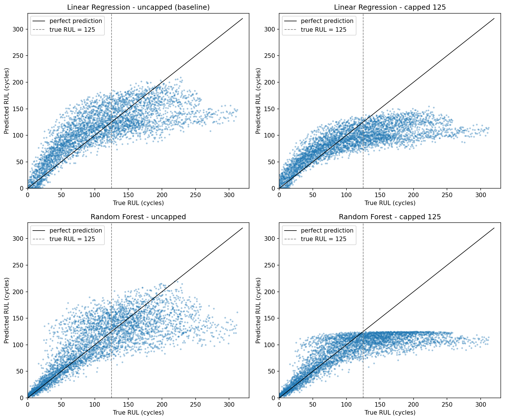
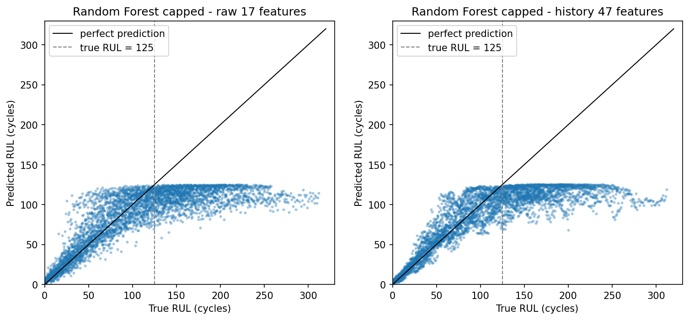
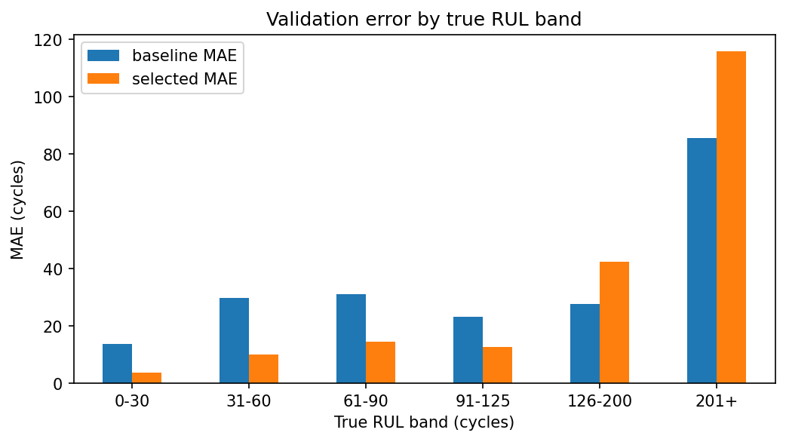
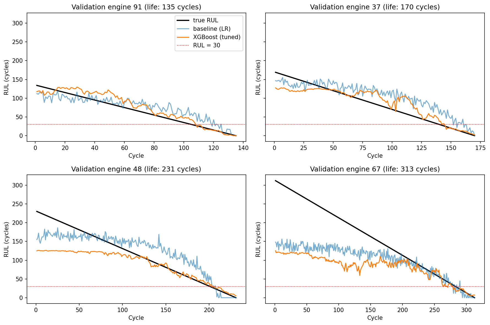
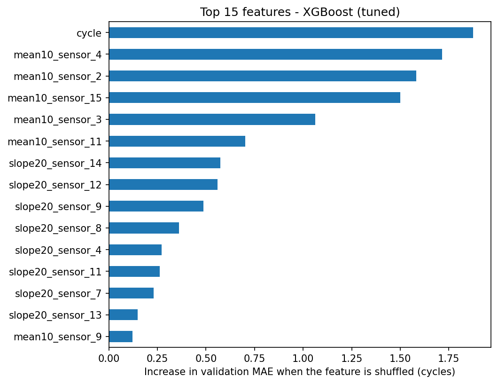
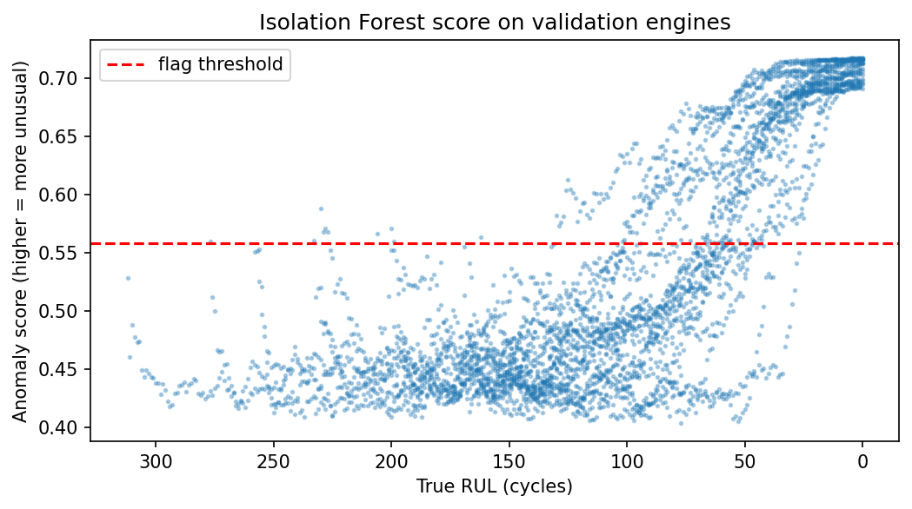

# 04 — Modeling

## Objective

Train Remaining Useful Life (RUL) models on the prepared NASA C-MAPSS FD001 tables, compare them with the Linear Regression baseline from Business Understanding, select one model for 05 — Evaluation, and build the unusual-sensor-behaviour signal (Isolation Forest) as a separate output.

## Deliverables

| Path | Content |
|---|---|
| `notebooks/04_modeling.ipynb` | Complete, executed modeling notebook |
| `models/selected_model.joblib` | Selected model (XGBoost) with its ordered feature list and history-feature recipe |
| `models/baseline_model.joblib` | Linear Regression baseline (scaler inside the pipeline) |
| `models/anomaly_detector.joblib` | Isolation Forest pipeline, threshold and settings |
| `models/model_card.json` | Parameters, feature list, dropped columns, scores, selection rule, library versions, notes for Evaluation |
| `outputs/*.csv` | Screening, tuning, paired CV, final comparison, error by RUL band, permutation importance, anomaly results, validation predictions |
| `outputs/figures/` | All figures used in this README |

## Running the notebook

Open `notebooks/04_modeling.ipynb` in Google Colab and select **Runtime → Run all**. The first cell clones the public repository and reads `03_data_preparation/outputs/`. The last cell downloads `modeling_results.zip` with `models/` and `outputs/`. A full run takes about 25–30 minutes, mostly for tuning. In a local clone, open the notebook from `04_modeling/notebooks/` and run all cells.

All random choices use `SEED = 42`. The official test table (`test_last_cycle.csv`) is **not loaded** in this stage.

## Evaluation design

All scores are computed on the 20 validation engines against the **original, uncapped RUL**. Predictions are clipped at 0. Error = prediction − truth, so a positive error is a **late** prediction (more life than the engine has, which delays inspection).

| Metric | Rows | Purpose |
|---|---|---|
| MAE, RMSE (all) | all 4,104 validation rows | comparison requested in the Data Preparation handoff |
| **MAE, RMSE (RUL ≤ 125)** | 2,520 rows inside the decision horizon | **selection metric** |
| MAE (RUL ≤ 30) | 620 rows close to failure | accuracy where decisions are urgent |
| Late share (RUL ≤ 30) | 620 rows | share predicted late by any amount |
| Late > 10 share (RUL ≤ 30) | 620 rows | share predicted late by more than 10 cycles |

**Why a decision horizon.** Early in a trajectory the engine is healthy and its sensors cannot distinguish 200 from 300 remaining cycles. Those errors dominate the all-rows score but do not change the planner's decision: the engine is not inspected either way. Inside the 125-cycle horizon, ranking engines correctly matters. The all-rows metrics are reported next to every result.

**Why "late > 10".** Tree models average leaf values, so very close to RUL = 0 they predict 1–2 cycles too high almost by construction. The plain late share counts these as late. Late predictions of more than 10 cycles are the ones that could delay a decision.

Model selection follows Business Understanding: **lowest validation MAE**, measured inside the decision horizon, applied in code. Hyperparameters are tuned only on the 80 training engines with engine-grouped cross-validation (`GroupKFold(5)` by `unit`), so the validation engines are never used for fitting or tuning.

## Experiments

### 1. Target: uncapped vs capped at 125 cycles (17 prepared features)

| Model | Target | MAE (all) | MAE (RUL ≤ 125) | MAE (RUL ≤ 30) | Late > 10 (RUL ≤ 30) |
|---|---|---|---|---|---|
| Linear Regression (baseline) | uncapped | 31.32 | 24.34 | 13.62 | 37.9% |
| Linear Regression | capped 125 | 36.10 | 16.30 | 13.92 | 51.0% |
| Random Forest | uncapped | 29.22 | 19.76 | 6.68 | 14.5% |
| Random Forest | capped 125 | 34.10 | 13.35 | 6.51 | 15.0% |

The cap lowers the error inside the decision horizon for both models and raises the all-rows error, because a capped model never predicts more than about 125 cycles. For Linear Regression the cap makes serious late predictions more frequent: a straight line cannot follow the "flat, then falling" capped target. Random Forest learns that shape. **All later experiments use the capped target.**

### 2. History features

For each sensor, computed within each engine from the current and earlier cycles only:

- `mean10_<sensor>`: mean of the last 10 cycles (smooths sensor noise)
- `slope20_<sensor>`: least-squares slope over the last 20 cycles (speed of change)

Random Forest, capped target:

| Features | MAE (RUL ≤ 125) | MAE (RUL ≤ 30) | Late > 10 (RUL ≤ 30) |
|---|---|---|---|
| 17 prepared features | 13.35 | 6.51 | 15.0% |
| + history (47) | **11.09** | **4.00** | **4.7%** |

History features remove most of the scatter and cut serious late predictions near failure by about two thirds.

### 3. Feature sets and model families (capped target, default settings)

MAE inside the decision horizon (RUL ≤ 125):

| Feature set | Random Forest | HistGradientBoosting | XGBoost |
|---|---|---|---|
| history (47) | 11.09 | 10.92 | 11.03 |
| history reduced (42) | 11.04 | 10.96 | 10.92 |
| history + cycle (48) | 10.45 | 10.30 | 10.29 |
| **history reduced + cycle (43)** | 10.47 | 10.30 | 10.30 |

- **Reduced** (without `sensor_6`, `setting_1`, `setting_2`): same accuracy with fewer features, as expected from Data Understanding (one operating condition; `sensor_6` is almost constant).
- **+ cycle**: a consistent improvement of about 6% in all three model families. The current cycle is known at prediction time. The total lifetime is never used.
- The simplest set among the best, **history reduced + cycle (43 features)**, is used for tuning.

### 4. Tuning and model comparison

Random search over each model's settings (default settings included as candidate 0), scored by grouped CV on the training engines.

| Model | CV MAE (RUL ≤ 125), default | CV MAE (RUL ≤ 125), tuned | CV std |
|---|---|---|---|
| Random Forest | 11.65 | 11.65 (default kept) | 0.90 |
| HistGradientBoosting | 11.54 | 11.45 | 0.69 |
| XGBoost | 11.46 | **11.26** | 0.69 |

Tuning gained only 0.1–0.2 cycles. Most of the improvement came from the capped target and the history features.

Because all models are scored on the same folds, they are also compared fold by fold (CV MAE, RUL ≤ 125):

| Fold | Random Forest | HistGradientBoosting | XGBoost | XGB − RF | XGB − HGB |
|---|---|---|---|---|---|
| 0 | 10.62 | 10.41 | 10.35 | −0.27 | −0.06 |
| 1 | 12.96 | 12.04 | 12.12 | −0.84 | +0.08 |
| 2 | 12.21 | 12.24 | 11.86 | −0.35 | −0.38 |
| 3 | 11.75 | 11.63 | 11.37 | −0.38 | −0.27 |
| 4 | 10.68 | 10.91 | 10.61 | −0.07 | −0.30 |

XGBoost is better than Random Forest in 5 of 5 folds and better than HistGradientBoosting in 4 of 5 folds.

## Results

Validation results for the baseline and every tuned model (`outputs/model_comparison.csv`):

| Model | Target | Features | CV MAE (RUL ≤ 125) | MAE (all) | RMSE (all) | **MAE (RUL ≤ 125)** | RMSE (RUL ≤ 125) | MAE (RUL ≤ 30) | Late > 10 (RUL ≤ 30) |
|---|---|---|---|---|---|---|---|---|---|
| Linear Regression (baseline) | uncapped | 17 prepared | – | 31.32 | 42.58 | 24.34 | 31.24 | 13.62 | 37.9% |
| Random Forest (tuned) | capped 125 | history reduced + cycle (43) | 11.65 | 30.05 | 46.77 | 10.47 | 14.10 | 3.94 | 4.2% |
| HistGradientBoosting (tuned) | capped 125 | history reduced + cycle (43) | 11.45 | 30.11 | 46.90 | 10.44 | 14.00 | 4.10 | 7.1% |
| **XGBoost (tuned)** | capped 125 | history reduced + cycle (43) | **11.26** | **29.89** | 46.71 | **10.27** | **13.96** | **3.59** | 4.4% |

### Selected model: XGBoost (tuned)

- **Settings:** `n_estimators=300`, `learning_rate=0.03`, `max_depth=6`, `subsample=0.7`, `colsample_bytree=0.6`, `min_child_weight=10`, `tree_method="hist"`, `random_state=42`
- **Target:** RUL capped at 125 cycles for training; predictions clipped at 0
- **Features:** 43 = 14 sensors + their 10-cycle means and 20-cycle slopes + current cycle

**Why this model.**

1. It has the lowest validation MAE inside the decision horizon (the Business Understanding rule): **10.27 cycles, 58% lower than the baseline's 24.34**.
2. It is also first in grouped cross-validation on the training engines, and it beats Random Forest in every fold.
3. Close to failure it has the lowest error (3.59 cycles) and serious late predictions fall from 37.9% (baseline) to 4.4%.
4. It is fast to train and its model file is small (about 0.4 MB).

The differences between the three tree models are small compared with fold-to-fold variation, so any of them would be a reasonable choice. XGBoost is selected because it is ahead on every indicator, not on one number alone. Over all rows, its MAE (29.89) is also below the baseline (31.32). Its all-rows RMSE (46.71) is higher than the baseline's (42.58), because the capped model makes large, deliberately conservative errors on healthy engines with more than 125 cycles left (see the table below).

### Where the selected model is accurate and where it is not

| True RUL | Rows | Baseline MAE | Selected MAE | Selected mean error |
|---|---|---|---|---|
| 0–30 | 620 | 13.62 | **3.59** | +2.04 |
| 31–60 | 600 | 29.75 | 10.09 | +7.01 |
| 61–90 | 600 | 31.23 | 14.45 | +8.34 |
| 91–125 | 700 | 23.29 | 12.76 | −3.45 |
| 126–200 | 1,181 | 27.64 | 42.42 | −42.42 |
| 201+ | 403 | 85.73 | 115.86 | −115.86 |

- Inside the decision horizon the error is 45–74% lower than the baseline in every band, with the largest gain closest to failure.
- Above 125 cycles the model is worse than the baseline by design: it never predicts more than about 125, so its errors there are always on the safe side (negative mean error equal to −MAE). A healthy engine may be inspected early; an engine close to failure is not missed.
- **Weak spot: 31–90 cycles.** The model is late by 7–8 cycles on average when degradation is starting, because it stays near the 125 plateau a little too long. Evaluation should check this range on the test set.

The trajectories show the planner's view. The selected model (orange) follows the true RUL closely in the last 30–50 cycles of every engine, while the baseline is noisy and late (engine 48: about 140 predicted when about 55 remain). Long-lived engines are harder: for engine 67 (313 cycles) the prediction dips to about 75 around cycle 100, when about 210 cycles remain (an early alarm).

### What the model uses

Permutation importance on validation rows with RUL ≤ 125 (increase in MAE, in cycles, when a feature is shuffled):

| Rank | Feature | MAE increase |
|---|---|---|
| 1 | `cycle` | 1.9 |
| 2 | `mean10_sensor_4` | 1.7 |
| 3 | `mean10_sensor_2` | 1.6 |
| 4 | `mean10_sensor_15` | 1.5 |
| 5 | `mean10_sensor_3` | 1.1 |
| 6 | `mean10_sensor_11` | 0.7 |

None of the top 15 features is a raw single-cycle reading; all are trailing means or slopes. Strongly correlated sensors (sensor_9 and sensor_14) share importance.

## Unusual sensor behaviour signal

A separate output that is **not a model input**:

- **Healthy reference:** first 30 cycles of each training engine, selected by cycle index. RUL is never a detector input.
- **Inputs:** 10-cycle trailing means of the 14 retained sensors.
- **Threshold:** 99% quantile of the reference scores, so about 1% of healthy rows are flagged by design.

| Validation rows | Rows | Flagged | Flag rate |
|---|---|---|---|
| RUL ≤ 30 | 620 | 616 | **99.4%** |
| RUL > 30 | 3,484 | 754 | 21.6% |

The Business Understanding criterion (higher flag rate in the final 30 cycles) is met. By true RUL band the flag rate is 99.4% (0–30), 81.3% (31–60), 31.7% (61–90), 8.7% (91–125), 0.7% (126–200) and 1.7% (201+). Most flags above 30 cycles fall where degradation has already started. In the healthy range the rate matches the designed ~1%.

**Sustained warning** (5 consecutive flagged cycles): all 20 validation engines receive one, at a median of **56 cycles before failure** (range 22–126). This falls in the 31–90 range where the RUL model tends to be late, so the two signals complement each other. A planner rule such as "inspect when predicted RUL ≤ X **or** a sustained warning is active" could be explored in Deployment.

FD001 contains one fault mode and no labelled anomalies, so this is an exploratory degradation-alignment measure, not anomaly precision or recall.

## Handoff to 05 — Evaluation

- Use `models/selected_model.joblib` and `models/baseline_model.joblib` exactly as saved. Both were fitted on the 80 training engines, so test results are directly comparable with the validation results above.
- The selected model and the anomaly detector need **history features**. Load each test engine's full trajectory (`test_FD001.txt`), compute the features with the same recipe (stored in the bundle), then predict at the last observed cycle and compare with the official RUL labels. `test_last_cycle.csv` contains only the last row per engine, which is enough for the baseline but not for history features.
- Load the bundles with the scikit-learn and XGBoost versions listed in `model_card.json` (scikit-learn 1.6.1, XGBoost 3.4.1).
- Points to check on the test set: errors in the 31–90 cycle range, late predictions close to failure, and early alarms on long-lived engines.

## Limitations

- FD001 is simulated, with one operating condition and one fault mode; results may not transfer to other conditions or fault types.
- The model uses the current cycle index, so it assumes engine lifetimes similar to this fleet (128–362 cycles in training).
- Validation contains 20 engines and was used to screen feature sets and to select the model, so validation scores are slightly optimistic. The untouched official test set in 05 — Evaluation gives the unbiased estimate.
- Above the 125-cycle horizon the model only says "healthy"; it does not estimate long remaining lives.

## Stage boundary

This stage does not load or evaluate the official test set. Test-set predictions, the final baseline-vs-selected comparison and the readiness decision for Deployment belong to 05 — Evaluation.
