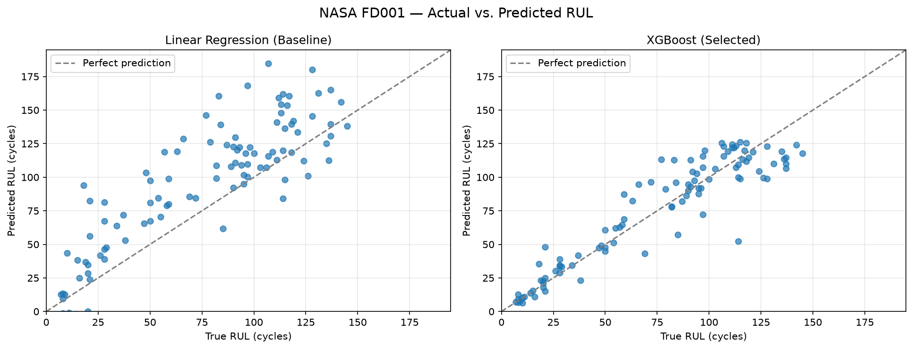
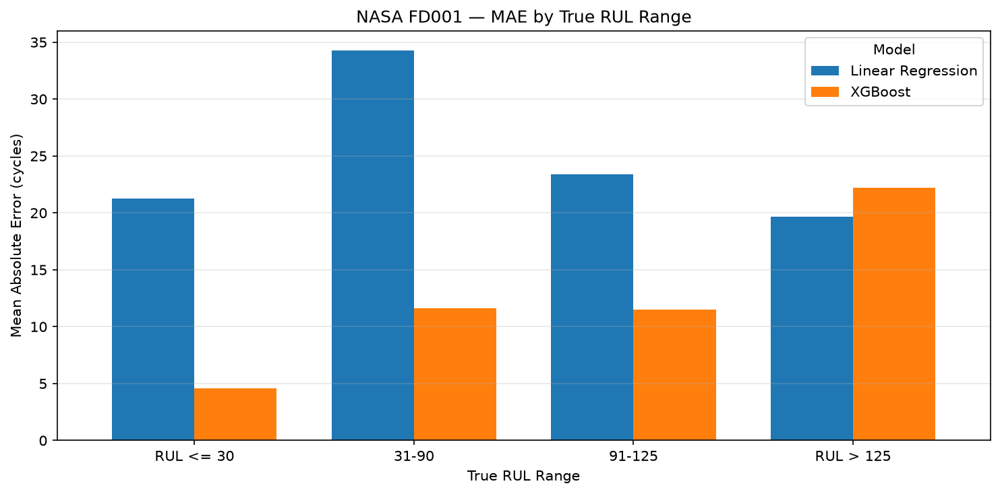
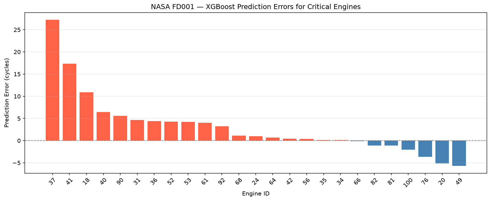
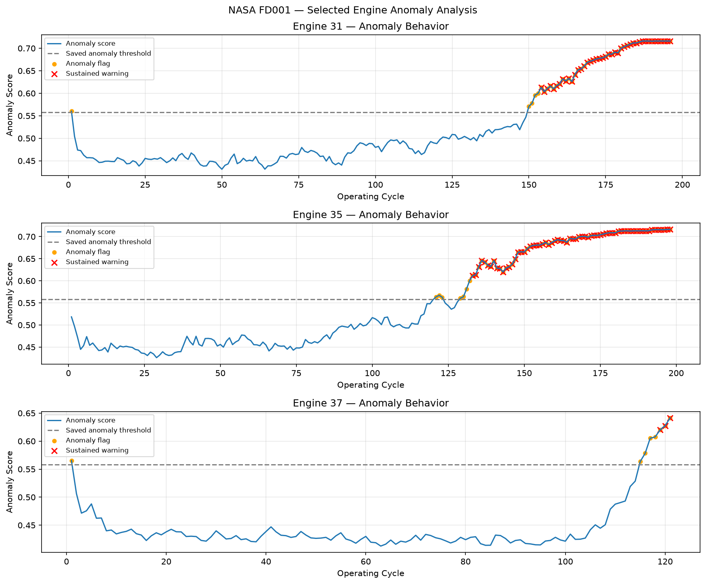

# 05 — Evaluation

## 1. Evaluation Objective & Business Context

This stage evaluates the predictive maintenance models developed during the Modeling phase of the CRISP-DM process.

Our project focuses on supporting maintenance planning by predicting the Remaining Useful Life (RUL) of simulated aircraft engines using NASA C-MAPSS FD001 sensor data.

The main objective is to determine whether the selected XGBoost model can provide sufficiently accurate RUL predictions on the previously unseen official test dataset.

In addition to prediction accuracy, we examine the practical implications of prediction errors for maintenance decisions. In particular, overestimating the remaining useful life of an engine close to failure may delay inspection and increase operational risk.

We also examine anomaly detection outputs to understand whether unusual sensor behavior can support early maintenance warnings.

The evaluation follows the objectives and success criteria defined in Business Understanding and uses the data preparation procedures and trained models established in the previous CRISP-DM stages.

## 2. Evaluation Scope and Methodology

The Evaluation stage uses the official NASA C-MAPSS FD001 test dataset to assess the models developed in Stage 04 — Modeling.

The evaluation includes:

- 100 official test engines.
- 13,096 test observations.
- Official engine-level RUL labels.
- The saved Linear Regression baseline model.
- The saved selected XGBoost model.
- The saved Isolation Forest anomaly detector.

The official test data was not used to train, tune, or select the models.

The selected model and its feature engineering configuration were reused from the Modeling stage.

RUL predictions were generated using each engine's last observed operating cycle and compared with the corresponding official RUL label.

The same official test engines were used to compare the baseline and selected models.

## 3. RUL Prediction Performance

The selected XGBoost model achieved substantially better performance than the Linear Regression baseline.

| Model | Test MAE (cycles) | Test RMSE (cycles) |
|---|---:|---:|
| Linear Regression | 25.603 | 31.969 |
| XGBoost (Selected) | 10.974 | 15.258 |

The selected XGBoost model reduced MAE by **57.14%** relative to the Linear Regression baseline.

This meets the original Business Understanding objective of achieving a lower official test MAE than the baseline.

### 3.1 Prediction Visualization

The following figure compares actual and predicted RUL values for the baseline and selected models.

The XGBoost predictions are generally closer to the actual RUL values, although individual prediction errors remain.

## 4. Performance Across RUL Ranges

Prediction performance was examined across different actual RUL ranges to understand where model errors occur.

| Actual RUL Range | Engines | Baseline MAE | XGBoost MAE |
|---|---:|---:|---:|
| RUL ≤ 30 | 25 | 21.255 | 4.598 |
| RUL 31–90 | 29 | 34.272 | 11.598 |
| RUL 91–125 | 35 | 23.391 | 11.471 |
| RUL > 125 | 11 | 19.664 | 22.234 |

XGBoost achieved considerably lower MAE in the critical RUL range.

However, its MAE was higher than the baseline for engines with RUL greater than 125 cycles.

This indicates that model performance varies across RUL ranges and that overall MAE alone does not describe every operational risk.

## 5. Critical Engine and Late Prediction Analysis

Special attention was given to engines with actual RUL ≤ 30 cycles.

This group contains 25 test engines.

The selected XGBoost model achieved:

- Critical engine MAE: **4.598 cycles**.
- Critical engine RMSE: **7.533 cycles**.
- RUL overestimations: **18 of 25 engines (72%)**.
- Average overestimation among these 18 engines: **5.338 cycles**.
- Maximum overestimation: **27.233 cycles**.

An overestimation means that the model predicts more remaining cycles than the engine actually has.

This is important because an overly optimistic RUL prediction could delay an inspection.

### 5.1 Example: Engine 37

Engine 37 had:

- Actual RUL: 21 cycles.
- Predicted RUL: 48.233 cycles.
- Prediction error: +27.233 cycles.

This was the largest RUL overestimation among the critical test engines.

Although XGBoost achieved low average error in the critical range, this example demonstrates that individual late predictions can still be substantial.

These results support using RUL predictions as decision-support information rather than automatic maintenance instructions.

## 6. Engine Inspection Prioritization

To evaluate practical maintenance planning, the 100 official test engines were ranked by their predicted RUL.

Engines with lower predicted RUL were assigned higher inspection priority.

The predicted top-10 engines were compared with the actual top-10 engines having the lowest official RUL.

The selected model correctly identified **9 of the 10** highest-priority engines.

**Top-10 Recall = 90%.**

This result supports the project's objective of helping maintenance planners prioritize inspections when inspection capacity is limited.

However, the ranking is not perfect, and a high-priority engine may be missed.

The ranking is available in:

`outputs/inspection_priority_ranking.csv`

## 7. Isolation Forest Anomaly Evaluation

The saved Isolation Forest detector was evaluated without retraining or adjusting its configuration.

The detector uses the original Modeling-stage settings:

- Anomaly threshold: `0.5578926205103545`.
- Anomaly score: higher values indicate more unusual behavior.
- Healthy reference: first 30 cycles of the training engines.
- Sustained warning requirement: 5 consecutive anomalous observations.

### 7.1 Official Test Results

The detector processed:

- 100 test engines.
- 13,096 sensor observations.
- 1,299 flagged observations.
- Overall anomaly flag rate: **9.92%**.

The overall flag rate represents the proportion of test observations identified as unusual. It does not represent an engine failure rate.

### 7.2 Sustained Anomaly Warnings

A sustained warning is identified when an engine records at least five consecutive anomalous observations.

This rule reduces reliance on isolated anomaly flags.

Selected examples:

| Engine | First Sustained Warning Cycle | Sustained Warning Observations |
|---|---:|---:|
| 31 | 154 | 43 |
| 35 | 133 | 66 |
| 37 | 119 | 3 |

Engine 31 showed a persistent increase in anomaly scores during later operating cycles.

Engine 35 demonstrated a longer sustained warning pattern.

Engine 37 showed a later increase in anomaly scores near the end of its observed trajectory.

### 7.3 Sensor Behavior Interpretation

The first and last 20 observed cycles of Engines 31, 35, and 37 were compared using historical sensor features.

| Engine | Feature with Largest Standardized Change | Change |
|---|---|---:|
| 31 | `mean10_sensor_13` | +25.366 |
| 35 | `mean10_sensor_9` | +29.266 |
| 37 | `mean10_sensor_12` | -21.624 |

These results describe changes in historical sensor features over the observed trajectories.

They are not Isolation Forest feature-importance values and do not establish which sensors caused the anomaly warnings.

Large standardized changes may also reflect low variability in the initial observation period.

Anomaly flags should therefore support further investigation rather than independently confirm a physical fault.

## 8. Verification of Business Understanding Success Criteria

The evaluation was compared with the original objectives established in Stage 01 — Business Understanding.

| Original Criterion | Evidence | Assessment |
|---|---|---|
| Lower official test MAE than Linear Regression | 10.974 vs. 25.603 | Met |
| Report RMSE | Both models evaluated | Met |
| Examine overestimation and underestimation | Critical engine error analysis completed | Met |
| Select the model using validation MAE | Previously selected XGBoost reused without test-based selection | Consistent with Modeling workflow |
| Higher Isolation Forest flag rate near failure on validation data | 99.35% vs. 21.64% | Supported by Modeling results |

### 8.1 Isolation Forest Validation Results

The Modeling-stage anomaly evaluation reported:

| Validation RUL Group | Observations | Flagged | Flag Rate |
|---|---:|---:|---:|
| RUL ≤ 30 | 620 | 616 | 99.35% |
| RUL > 30 | 3,484 | 754 | 21.64% |

Anomaly flags were substantially more frequent near the final 30 remaining cycles.

This supports the qualitative criterion established during Business Understanding.

These values describe degradation alignment, not anomaly precision or recall, because the dataset does not provide independently labeled anomalous observations.

The official test data was not used to select the anomaly detector threshold.

## 9. Limitations

The following limitations should be considered when interpreting the results:

1. The NASA C-MAPSS FD001 dataset is simulated and does not represent a complete real-world aircraft maintenance environment.
2. FD001 includes one operating condition and one fault mode.
3. The official test evaluation includes 100 engines.
4. The selected model has important individual prediction errors, especially some RUL overestimations near failure.
5. The Modeling-stage RUL target cap of 125 cycles can limit interpretation of longer-range RUL predictions.
6. Isolation Forest identifies unusual sensor patterns but does not confirm physical faults.
7. Inspection rankings do not directly establish cost savings, reduced downtime, or operational safety.
8. Additional real-world validation would be necessary before operational deployment.

## 10. Deployment Readiness Assessment

The selected XGBoost model demonstrates promising performance for simulation-based predictive maintenance decision support.

The evaluation supports:

- Estimating engine RUL using previously observed sensor data.
- Ranking engines by predicted maintenance priority.
- Identifying unusual sensor behavior using the saved anomaly detector.
- Presenting risk information to a maintenance planner.

However, the model is **not ready for fully autonomous real-world aircraft maintenance decisions**.

The recommended next step is a controlled, simulation-based Deployment demonstration.

Such a demonstration should include human review, clear explanations of prediction uncertainty and limitations, and appropriate safeguards against late RUL predictions.

## 11. Evaluation Artifacts

### 11.1 Notebook

The Evaluation notebook is located at:

`notebooks/05_evaluation.ipynb`

### 11.2 CSV Outputs

All generated CSV files are stored in `outputs/`:

| File | Description |
|---|---|
| `test_rul_predictions.csv` | Official test RUL predictions for 100 engines |
| `model_test_metrics.csv` | Baseline and XGBoost test performance |
| `rul_band_metrics.csv` | Prediction metrics across RUL ranges |
| `critical_engine_predictions.csv` | Prediction results for critical engines |
| `inspection_priority_ranking.csv` | Predicted inspection priority ranking |
| `test_anomaly_scores.csv` | Cycle-level anomaly scores and flags |
| `sustained_anomaly_warnings.csv` | Cycle-level consecutive anomaly warnings |
| `engine_warning_summary.csv` | Engine-level warning summary |
| `selected_engine_sensor_comparison.csv` | Descriptive sensor feature comparisons |

### 11.3 Figures

Generated visualizations are stored in `outputs/figures/`:

- `actual_vs_predicted_rul.png`
- `mae_by_rul_range.png`
- `critical_engine_prediction_errors.png`
- `selected_engine_anomaly_behavior.png`

### 11.4 Models

The Evaluation stage reuses models from:

`../04_modeling/models/`

These models include:

- `baseline_model.joblib`
- `selected_model.joblib`
- `anomaly_detector.joblib`
- `model_card.json`

No new models were trained during Evaluation.

## 12. Reproducibility and Data Handling

The notebook uses the original FD001 test data and the saved model artifacts from the previous CRISP-DM stages.

The test files are stored locally under `05_evaluation/data/` and are excluded from Git tracking.

The evaluation workflow checks the required test data files against the dataset inventory before using them.

The notebook is designed to:

1. Locate the project and saved model artifacts.
2. Verify and load the official test data.
3. Reconstruct the required model features.
4. Generate engine-level RUL predictions.
5. Calculate baseline and selected model metrics.
6. Analyze critical prediction errors.
7. Rank engines by inspection priority.
8. Evaluate anomaly scores and sustained warnings.
9. Examine selected engine sensor behavior.
10. Export CSV results and figures.

The official test set is reserved for evaluation, not model tuning or selection.

## 13. Final Evaluation Conclusion

The selected XGBoost model achieved a test MAE of **10.974 cycles** and improved MAE by **57.14%** relative to the Linear Regression baseline.

It also achieved **90% Top-10 Recall** in the inspection prioritization analysis.

The saved Isolation Forest detector provided complementary evidence of unusual sensor behavior, while the Modeling-stage validation results supported the original degradation-alignment objective.

However, critical late prediction errors remain a significant limitation.

Overall, the Evaluation results support proceeding to a controlled, simulation-based Deployment demonstration with human oversight.

They do not justify autonomous operational aircraft maintenance decisions.

